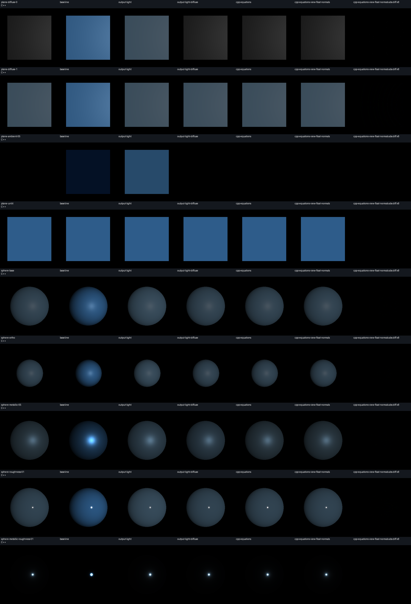

# Opaque PBR isolation: vtk.js WebGPU and C++ VTK

The lighting mismatch is reproducible with ordinary opaque rendering. Controlled
variants identify differences in light scale, output encoding, material terms,
BRDF equations, normal precision and orthographic view vectors. Aligning these
in the diagnostic harness leaves eight of twenty-two scenes strictly identical;
fourteen retain differences of at most one channel level. Physical correctness
and the intended public API semantics remain undecided.
[Measurements](evidence/summary.json)

## Comparison conditions

The [fixture generator](prepare-specs.py) defines twenty-two scenes. Each uses
one opaque actor with explicit point normals, scalar coloring disabled, a
shared SHA256-checked VTP, 256 by 256 output, one sample per pixel, a black opaque
background, and deep transparency disabled. Automatic lights and image-based
lighting are disabled. Main tests use a directional SceneLight and perspective
projection. Ambient controls retain a black light to avoid C++'s separate
no-lights fallback. An orthographic sphere tests projection separately.

The pinned native reference is
[VTK `efc4afbd7430e8eddf86759c5d70711af89e50f0`](https://github.com/Kitware/VTK/tree/efc4afbd7430e8eddf86759c5d70711af89e50f0).
Both captures use Vulkan/SwiftShader, but native and browser runs use different
SwiftShader builds. The [capture metadata](evidence/capture-metadata.json)
records their distinct library hashes. This limits attribution of the smallest
remaining differences. The
[evidence manifest](evidence/manifest.json) records source and runtime
provenance, capture conditions and artifact hashes. The published
[scene specifications](evidence/scene-specifications.json) and capture metadata
normalize machine-specific paths; the manifest distinguishes normalized-file
hashes from original recorded identifiers. The
[original translucent comparison](../../comparison/REPORT.md) provides broader
dataset context; its images do not isolate individual lighting terms.

There are twenty-two native captures and nineteen browser variants per scene,
for 418 browser captures. Capture validation checks errors, sample counts,
disabled deep transparency, specification and mesh checksums, geometry counts
and final shader checksums. The unlit plane is exact across all 65,536 RGBA
pixels, including center `[46,92,138,255]`.
[Validation and measurements](evidence/summary.json)

Strict comparisons include every RGBA channel with zero tolerance and no
registration or spatial allowance. All MAE figures below are whole-image RGB
mean absolute error in output levels from 0 to 255, including the black
background. Optional interior and center measurements remain separate
diagnostics. The harness leaves production rendering and demo sources
unchanged; substitutions are confined to the
[fixture implementation](shader-variants.mjs).

## Verified causes

### Light scale and output encoding partially compensate

[vtk.js light upload](../../Sources/Rendering/WebGPU/Renderer/index.js#L221)
multiplies public intensity by five. The
[native light upload](https://github.com/Kitware/VTK/blob/efc4afbd7430e8eddf86759c5d70711af89e50f0/Rendering/WebGPU/vtkWebGPULight.cxx#L36)
uses color times intensity.

The [vtk.js PBR output](../../Sources/Rendering/WebGPU/CellArrayMapper/Replacements/Lighting.js#L349)
writes the accumulated value directly.
[C++ output](https://github.com/Kitware/VTK/blob/efc4afbd7430e8eddf86759c5d70711af89e50f0/Rendering/WebGPU/vtkWebGPUPolyDataMapper.cxx#L376)
applies `pow(max(color,0),1/2.2)`. This is a power function, not the piecewise
sRGB transfer function. Native
[property colors are uploaded raw](https://github.com/Kitware/VTK/blob/efc4afbd7430e8eddf86759c5d70711af89e50f0/Rendering/WebGPU/vtkWebGPUActor.cxx#L426);
the [scalar-color linearization condition](https://github.com/Kitware/VTK/blob/efc4afbd7430e8eddf86759c5d70711af89e50f0/Rendering/WebGPU/vtkWebGPUPolyDataMapper.cxx#L4182)
is inactive in these scalar-free fixtures.

On `sphere-base`, applying only output parity worsens MAE from 5.391841 to
25.145167. Combining output parity with radiance divided by five reduces it to
2.000025. Thus either isolated change can give a misleading account of the
baseline image. Independent float64 plane-center predictions are included in
the measurements and reproduce the observed rounded values.
[Results and predictions](evidence/summary.json)

### Diffuse and ambient parameters have different effects

The [vtk.js base-color expression](../../Sources/Rendering/WebGPU/CellArrayMapper/Replacements/Lighting.js#L56)
omits the uploaded diffuse coefficient.
[C++ albedo](https://github.com/Kitware/VTK/blob/efc4afbd7430e8eddf86759c5d70711af89e50f0/Rendering/WebGPU/vtkWebGPUPolyDataMapper.cxx#L85)
multiplies diffuse color by that coefficient. Sweeping diffuse from zero to one
changes C++ plane-center RGB from `[39,39,39]` to `[64,80,93]`, while vtk.js
stays at `[60,100,140]`. After output and light alignment, adding diffuse parity
reduces `sphere-base` MAE from 2.000025 to 0.037257. Zero diffuse still permits
dielectric specular reflection.
[Diffuse sweep and sphere variants](evidence/summary.json)

[vtk.js ambient](../../Sources/Rendering/WebGPU/CellArrayMapper/Replacements/Lighting.js#L325)
adds `ambientIntensity * ambientColor * baseColor`, giving `A*C*C` with
`setColor(C)`. C++ computes ambient but
[clears the accumulator on the lit path](https://github.com/Kitware/VTK/blob/efc4afbd7430e8eddf86759c5d70711af89e50f0/Rendering/WebGPU/vtkWebGPUPolyDataMapper.cxx#L301)
before direct-light accumulation. Under a black light at ambient .5, native
center RGB is `[0,0,0]`; vtk.js is `[4,17,37]`, matching `255*.5*C*C`.
Removing only vtk.js ambient makes the entire control image exact.
Diffuse-one ambient fixtures separately control for a zero-albedo interaction.
[Ambient controls](evidence/summary.json)

### Correlated visibility and mixed-metal Fresnel differ

[vtk.js visibility](../../Sources/Rendering/WebGPU/CellArrayMapper/Shaders.js#L68)
receives squared roughness and squares it again, so its visibility expression
uses roughness to the fourth power.
[C++ visibility](https://github.com/Kitware/VTK/blob/efc4afbd7430e8eddf86759c5d70711af89e50f0/Rendering/WebGPU/wgsl/PBRFunctions.wgsl#L45)
uses roughness squared. The distribution uses roughness to the fourth power
on both sides. Aligning visibility reduces `sphere-base` MAE from 0.037257 to
0.029989.
[Visibility variants](evidence/summary.json)

[vtk.js](../../Sources/Rendering/WebGPU/CellArrayMapper/Replacements/Lighting.js#L262)
mixes separate dielectric and metallic BRDFs; C++
[mixes F0/F90 first](https://github.com/Kitware/VTK/blob/efc4afbd7430e8eddf86759c5d70711af89e50f0/Rendering/WebGPU/vtkWebGPUPolyDataMapper.cxx#L232)
and uses that mixed
[Fresnel term to attenuate diffuse](https://github.com/Kitware/VTK/blob/efc4afbd7430e8eddf86759c5d70711af89e50f0/Rendering/WebGPU/wgsl/PBRFunctions.wgsl#L121).
At metallic .5, adding Fresnel parity after output, light, diffuse, ambient and
visibility alignment reduces MAE from 0.827347 to 0.047185. The mixed-metal
distinction vanishes at metallic endpoints when F90 is one. Low-IOR controls
also exercise F90 handling.
[Metallic and IOR controls](evidence/summary.json)

### Packed normals explain the sharp-highlight residual

[vtk.js vertex input](../../Sources/Rendering/WebGPU/CellArrayMapper/VertexInput.js#L160)
requests supplied normals as `snorm8x4`, scaled by 127 and packed by the
[buffer manager](../../Sources/Rendering/WebGPU/BufferManager/index.js).
C++ retains supplied normals as float32 in its
[normal buffer](https://github.com/Kitware/VTK/blob/efc4afbd7430e8eddf86759c5d70711af89e50f0/Rendering/WebGPU/vtkWebGPUPolyDataMapper.cxx#L1467).

After equation alignment, roughness .1 retains maximum error 75; the metallic
roughness .1 sphere retains maximum error 66 around its highlight. A diagnostic
float32 normal-buffer variant reduces both maxima to one. Ordinary-sphere MAE
falls from 0.029989 to 0.003591. This intervention supplies rendered causal
evidence for normal precision.
[Sharp residual locations](evidence/sharp-residual.json),
[normal-format variants](evidence/summary.json)

The combined diagnostic also aligns C++ angle clamps and its distribution
denominator floor, `1e-8` rather than vtk.js `1e-6`. These arithmetic changes
alone leave the sharp residual; the normal-buffer intervention removes its
large errors.
[Arithmetic implementation](shader-variants.mjs),
[residual measurements](evidence/sharp-residual.json)

### Orthographic view vectors differ

[vtk.js](../../Sources/Rendering/WebGPU/CellArrayMapper/Replacements/Lighting.js#L54)
uses `[0,0,1]` in parallel projection.
[C++](https://github.com/Kitware/VTK/blob/efc4afbd7430e8eddf86759c5d70711af89e50f0/Rendering/WebGPU/vtkWebGPUPolyDataMapper.cxx#L162)
always derives the view vector from fragment position. After equation and
normal alignment, using the C++ convention reduces orthographic-sphere MAE
from 0.042425 to 0.001572. This establishes a cause of the comparison difference,
not a preferred projection convention.
[Orthographic variants](evidence/summary.json)

## Final whole-image results

The final variant, `cpp-equations-view-float-normals`, combines equation, light,
view-vector and normal-format alignment. Across all twenty-two scenes, eight
are exact and fourteen differ by at most one channel level. Alpha agrees in
every final comparison.
[Complete result set](evidence/summary.json)

| Scene                          |  RGB MAE | Differing RGBA pixels / 65,536 | Maximum channel error |
| ------------------------------ | -------: | -----------------------------: | --------------------: |
| `plane-unlit`                  | 0.000000 |                              0 |                     0 |
| `sphere-base`                  | 0.003591 |                            693 |                     1 |
| `sphere-metallic-05`           | 0.002803 |                            542 |                     1 |
| `sphere-roughness-01`          | 0.003972 |                            766 |                     1 |
| `sphere-metallic-roughness-01` | 0.000290 |                             57 |                     1 |
| `sphere-ortho`                 | 0.001572 |                            304 |                     1 |

Table source: each named scene's
`variants.cpp-equations-view-float-normals.fullImage` in
[`summary.json`](evidence/summary.json).

## Remaining hypotheses and next steps

Native output uses RGBA8Unorm; browser opaque output uses RGBA16Float before
byte conversion. These formats are recorded in the
[capture evidence](evidence/manifest.json) and [measurements](evidence/summary.json).
Half-float storage, byte conversion, floating-point expression evaluation and
the different SwiftShader builds are plausible causes of the remaining one-level differences. Their
contributions have not been isolated. A next precision experiment should
control attachment/readback format and compare linear floating output before
byte conversion. The zero-tolerance criterion remains unmet for fourteen
scenes.

Before proposing a production change, choose intended light, output-color,
diffuse/ambient, metallic-workflow and projection semantics. Matching C++
equations does not establish that C++ supplies the preferred physical model or
API reference. Normal precision also carries storage and bandwidth costs that
need evaluation. Once those choices are settled, the public-API fixtures can
provide targeted regression coverage.

Point-light attenuation, spotlight falloff and single-headlight behavior also
differ in source
([vtk.js light loop](../../Sources/Rendering/WebGPU/CellArrayMapper/Replacements/Lighting.js#L169),
[C++ light loop](https://github.com/Kitware/VTK/blob/efc4afbd7430e8eddf86759c5d70711af89e50f0/Rendering/WebGPU/vtkWebGPUPolyDataMapper.cxx#L257)).
Those paths were not exercised here. IBL, textures, clearcoat, transmission,
other devices and the original translucent datasets require separate coverage.

The [README](README.md) gives reproduction commands. The
[evidence manifest](evidence/manifest.json) indexes lossless native and browser
PNG captures, deduplicated WGSL keyed by hash, normalized scene and capture
metadata, the [measurement summary](evidence/summary.json), the
[comparison image](evidence/comparison.png), and
[sharp-residual diagnostics](evidence/sharp-residual.json). These files permit
independent checks of the reported image differences.
